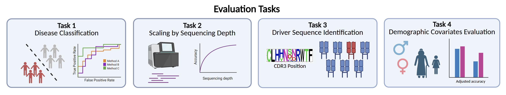

# BenchRep-T: A Systematic Evaluation of T-Cell Repertoire-Based Disease Diagnostics

A person's T-cell receptor (TCR) repertoire records their immune history and can 
support diagnosing many diseases from a single blood sample. Many methods have been proposed for TCR repertoire-based diagnosis, but each was evaluated on different cohorts, preprocessing, and splits, which makes them hard to compare.

**BenchRep-T** is a unified benchmark for TCRβ repertoire-based disease
classification. It harmonizes cohorts from Zaslavsky et al. (Mal-ID), Mitchell
et al., Rawat et al., Musvosvi et al., Savola et al., and Emerson et al. into a
single AIRR-compliant schema, and evaluates statistical, feature-engineered,
clustering, and deep-learning methods on identical inputs and fixed 3-fold
cross-validation splits.

| Cohort | Prediction task | Repertoires | Class composition |
|--------|-----------------|------------:|-------------------|
| Zaslavsky/Mal-ID | HIV, T1D, Lupus, COVID-19, Influenza vs Healthy/Background | 550 | 197 Healthy/Background; 98 HIV; 96 T1D; 64 Lupus; 58 COVID-19; 37 Influenza |
| Mitchell | T1D vs Healthy/Background | 196 | 171 T1D; 25 Healthy/Background |
| Rawat | T1D vs Healthy/Background | 614 | 426 T1D; 188 Healthy/Background |
| Musvosvi | TB progression vs control | 140 | 63 Progressor; 77 Controller |
| Savola | Rheumatoid Arthritis vs Healthy | 91 | 71 RA; 20 Healthy |
| Emerson | CMV seropositive vs seronegative | 761 | 340 CMV+; 421 CMV− |

BenchRep-T defines four evaluation tasks:



1. **Disease classification** — binary disease vs control within each cohort,
   cross-cohort transfer for T1D, and a pooled Mal-ID + Mitchell T1D split.
   Metrics: AUROC, AUPR.
2. **Sequencing-depth scaling** — reruns classification after downsampling every
   Mal-ID repertoire to D ∈ {1k, 5k, 10k, 25k, 50k, 75k} sequences, with five
   replicates per depth.
3. **Driver-sequence identification** — whether per-sequence scores recover
   known antigen-specific TCRs (VDJdb, plus Minervina et al. for SARS-CoV-2),
   matched at ≥90% Levenshtein similarity. Metric: recall@k for k ∈ {100, 1000,
   10000}. Mal-ID HIV, Influenza, and COVID-19 only.
4. **Demographic confounding** — compares demographic-matched controls against
   random controls, and concatenates age, sex, and ancestry with each method's
   repertoire features.

## Setup

Requires Python ≥ 3.10. Mal-ID-Lite
([liel-cohen/Mal-ID-Lite](https://github.com/liel-cohen/Mal-ID-Lite)) is a git
submodule, so clone with submodules:

```bash
git clone --recurse-submodules https://github.com/boyd-lab/BenchRep-T.git
# or, in an existing clone:
git submodule update --init models/Mal-ID-Lite
```

Each method family has its own Conda environment, because their framework pins
conflict (for example, DeepTCR needs TensorFlow 2.15 and Biopython 1.76):

| Environment | File | Methods |
|-------------|------|---------|
| `benchrep-base` | `environment-base.yml` | Emerson, Ostmeyer, Ensemble Regression/XGBoost, shared utilities |
| `abmil` | `environment-abmil.yml` | ABMIL and pretrained-encoder variants |
| `giana` | `environment-giana.yml` | GIANA |
| `deeprc` | `environment-deeprc.yml` | DeepRC |
| `deeptcr` | `environment-deeptcr.yml` | DeepTCR |
| `mal_id_lite` | `environment-mal-id-lite.yml` | Mal-ID-Lite |

```bash
for f in base abmil giana deeprc deeptcr mal-id-lite; do
    conda env create -f environment-${f}.yml
done
for env_name in benchrep-base abmil giana deeprc deeptcr mal_id_lite; do
    conda run -n "${env_name}" python -m pip install --no-deps -e .
done
```

The same groups are available as `pyproject.toml` extras (`uv sync --extra abmil`,
`pip install -e ".[deeprc]"`, and so on). Install one extra per environment; do
not combine them.

**GPU.** Every environment ships its own CUDA runtime through its wheels, so no
system CUDA toolkit is needed (tested on H200 and L40S). A system CUDA on
`LD_LIBRARY_PATH` can shadow those libraries and cause errors such as
`undefined symbol: __nvJitLinkAddData_12_1`. If that happens, run without it:

```bash
env -u LD_LIBRARY_PATH bash examples/run_all_disease_classification.sh
```

## Data

The preprocessed dataset is public on Hugging Face at
[lordim/BenchRep-T](https://huggingface.co/datasets/lordim/BenchRep-T); no
account or token is needed.

```bash
benchrep-download-data                                    # everything (14.6 GiB)
benchrep-download-data --task disease --cohort ra         # one task and cohort
benchrep-download-data --task drivers                     # Mal-ID + driver matches
benchrep-download-data --task depth                       # Mal-ID + depth indices
benchrep-download-data --task disease --cohort tb --dry-run
benchrep-download-data --validate-only                    # check existing files offline
```

Cohort names are `malid`, `mitchell-t1d`, `rawat-t1d`, `tb`, `ra`, and `cmv`.
`--revision` pins a dataset commit. The downloaded layout is:

```text
data/
├── Mal-ID/
│   ├── metadata.tsv
│   ├── repertoires/                                # 550 .tsv.gz
│   ├── scaling_exp_depth_indices_max75k.json.gz    # depth task
│   └── vdjdb_minervina_driver_seq_matches.csv      # driver task
└── immunoSEQ/
    └── {Mitchell_T1D,Rawat_T1D,Musvosvi_TB,Savola_RA,Emerson_CMV}/
        ├── metadata.tsv
        └── repertoires/
```

Repertoires are gzip-compressed AIRR TSVs with `cdr3_aa`, `v_call` (IMGT, e.g.
`TRBV7-2*01`), `j_call`, and an optional `duplicate_count`. Metadata files share
`participant_label`, `specimen_label`, `disease`, a fold column
(`malid_cross_validation_fold_id_when_in_test_set` or `CV_fold`, values 0–2), and
`age`, `sex`, `ancestry` where available.

## Methods

| Method | Family | Approach |
|--------|--------|----------|
| Emerson et al. 2017 | Statistical | Fisher's exact test for disease-associated CDR3s, scored with a Beta-Binomial model |
| Ostmeyer et al. 2019 | Statistical | Multiple-instance learning over Atchley-encoded CDR3 4-mers |
| Ensemble Regression | Engineered features | L1 logistic regressions on V/J usage and gapped 4-mers, linearly combined |
| Ensemble XGBoost | Engineered features | The same features with gradient-boosted trees |
| GIANA (Zhang et al. 2021) | Clustering | Isometric CDR3 encoding and clustering; scores by cluster disease fraction |
| ABMIL | Deep learning | CNN sequence encoder with gated-attention pooling |
| DeepRC (Widrich et al. 2020) | Deep learning | CNN embeddings with Hopfield attention over up to ~10⁵ sequences |
| DeepTCR (Sidhom et al. 2021) | Deep learning | CDR3 + V/D/J encoder with attention pooling over a concept bank |
| Mal-ID-Lite (Zaslavsky et al. 2025, reimpl.) | Ensemble | V/J usage, convergent CDR3 clusters, and ESM-2 embeddings, combined by a ridge metamodel |

```
models/                  Method implementations (Mal-ID-Lite is a git submodule)
evals/                   Per-method experiment scripts
examples/                One runner per evaluation task
preprocessing/           Repertoire cleaning, depth indices, driver matching
external_data_process/   Cohort-specific conversion to AIRR format
utils/                   Repertoire I/O, metrics, cohort merging, gene harmonization
```

## Running the benchmark

Each task has one runner in `examples/`. Runners download the data they need,
stage symlinked inputs under `results/` (downloaded files are never modified),
and run every method in its own Conda environment.

| Runner | Default scope |
|--------|---------------|
| `run_all_disease_classification.sh` | 9 methods × 11 cohort/disease tasks = 99 runs |
| `run_all_driver_identification.sh` | 6 methods × 3 diseases = 18 runs, plus a random-chance baseline |
| `run_all_depth_scaling.sh` | 4 methods × Lupus, HIV, each over 6 depths × 5 replicates |
| `run_all_demographic_analysis.sh` | Matched controls (56 runs) and feature concatenation (28 runs) |

Every runner accepts `DRY_RUN=1 DOWNLOAD_DATA=0`, which prints each command
without downloading or training. Common overrides are `METHODS`, `DATASETS` or
`DISEASES`, `OUTPUT_ROOT`, `USE_GPU`, `N_JOBS`, and `N_THREADS`; the variable
block at the top of each script lists the rest.

```bash
DATASETS=ra bash examples/run_all_disease_classification.sh        # one cohort
DATASETS=malid+mitchell-t1d bash examples/run_all_disease_classification.sh
DEPTHS=1000 REPLICATES=1 bash examples/run_all_depth_scaling.sh    # quick check
```

Notes on specific runners:

- **Pooled cohorts.** `malid+mitchell-t1d` trains and tests Mal-ID and Mitchell
  T1D together, with each specimen keeping its assigned fold. Pooled runs
  canonicalize V/J labels (strip alleles, collapse the Adaptive-style `-1` suffix
  on singleton families) so both cohorts share one gene vocabulary;
  within-cohort runs keep native labels. Any evaluator can be pooled by passing
  `--ext_metadata_path`, `--ext_data_dir`, and `--ext_file_template`. Cross-cohort
  transfer, which trains on one cohort and tests on another, is a separate
  protocol in `evals/zeroshot_disease_classification.py`.
- **Driver identification.** Ensemble XGBoost only scores sequences with models
  saved by disease classification, so point it at that run:

  ```bash
  OUTPUT_ROOT=results/disease bash examples/run_all_disease_classification.sh
  DISEASE_RUN_ROOT=results/disease bash examples/run_all_driver_identification.sh
  ```

  The other methods reuse those checkpoints when present and train their own otherwise.
- **Depth scaling.** Subsampling uses the published indices file, so every user
  draws the same rows. Draws are nested (each depth's sequences are a subset of
  the next depth's), and specimens with fewer than 75k unique sequences are
  excluded at every depth. Ostmeyer, GIANA, the Ensemble sub-model ablations,
  and Mal-ID-Lite are supported but opt-in through `METHODS`. Mal-ID-Lite trains
  all diseases together per (depth, replicate); see
  `evals/mal_id_lite_depth_experiment.py` for details.
- **Demographic analysis.** `ANALYSES` selects `matched_controls` or
  `feature_concat`. Matched controls use age for Lupus, Influenza, and COVID-19
  and African ancestry for HIV, compared against five random-control draws;
  GIANA is excluded because it has no random-baseline mode. Feature
  concatenation covers a demographics-only baseline and V/J-gene, ABMIL, and
  DeepTCR models, with and without demographics.

## Preprocessing

All cohorts are converted to the same AIRR schema. The Mal-ID adapter
(`preprocessing/`) drops non-productive and low-confidence rows and collapses
V-gene alleles indistinguishable under the FR3 primer set (Meysman et al.). The
immunoSEQ adapters (`external_data_process/`) convert Adaptive column and gene
names to AIRR/IMGT form, strip alleles, trim the conserved flanking C and F from
each CDR3, and drop specimens with fewer than 1,000 unique sequences where the
cohort protocol requires it.

## Citation

BenchRep-T is described in our NeurIPS 2026 Evaluations and Datasets Track paper,
also available as a [bioRxiv preprint](https://www.biorxiv.org/content/10.64898/2026.06.09.727013v1):

> Alejandro Buendia\*, Chiho Im\*, Anshul Kundaje, Scott D. Boyd, and Liel Cohen-Lavi.
> BenchRep-T: A Systematic Evaluation of T-Cell Repertoire-Based Disease Diagnostics.
> *NeurIPS 2026 Evaluations and Datasets Track.* (\*co-first authors)

```bibtex
@inproceedings{buendia2026benchrept,
  title     = {{BenchRep-T}: A Systematic Evaluation of {T}-Cell Repertoire-Based Disease Diagnostics},
  author    = {Buendia, Alejandro and Im, Chiho and Kundaje, Anshul and Boyd, Scott D. and Cohen-Lavi, Liel},
  booktitle = {Advances in Neural Information Processing Systems (NeurIPS), Evaluations and Datasets Track},
  year      = {2026},
  note      = {Alejandro Buendia and Chiho Im contributed equally. bioRxiv preprint},
  url       = {https://www.biorxiv.org/content/10.64898/2026.06.09.727013v1}
}
```
